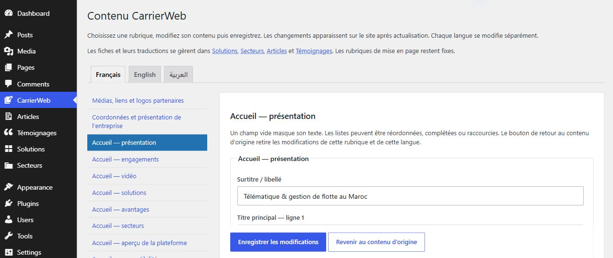

# CarrierWeb Maroc

WordPress theme for the CarrierWeb Maroc website, with French, Arabic and English content. The site presents fleet-management solutions, transport sectors, customer references and resource articles, with a contact form and links to the client portal.

The pages are rendered by PHP templates. Tailwind CSS supplies the styles, and plain JavaScript handles navigation, FAQs, the theme switch and form feedback. There is no React frontend or Next.js server. The compiled assets are included, so Node is only needed when rebuilding CSS or JavaScript.

## Website

- Homepage with a hero image, video section, solutions, sectors, benefits, testimonials and FAQs.
- Solution and sector listings with individual detail pages.
- Resource articles, company information and customer references.
- Contact form and client portal links.
- French, English and Arabic navigation, including right-to-left Arabic layouts.
- Responsive menus and light/dark display modes.

The platform preview uses demonstration figures. Fleet tracking and client authentication belong to CarrierWeb's external portal.

## Content editing

Content is managed in the WordPress dashboard. The theme keeps the layout consistent while editors update the fields below.

| Content | WordPress screen |
| --- | --- |
| Page headings, paragraphs, buttons and FAQs | **CarrierWeb → Textes et médias**, then select a language and section |
| Logo, homepage image, video and partner logos | **CarrierWeb → Médias, liens et logos partenaires** |
| Address, telephone and email | **CarrierWeb → Coordonnées et présentation de l’entreprise** |
| Solution cards and detail pages | **Solutions** |
| Sector cards and detail pages | **Secteurs** |
| Resource articles | **Articles** |
| Customer quotes | **Témoignages** |
| Menu links and their order | **Appearance → Menus** |
| Legal and privacy page content | **Pages** |



Choose the language, edit a section, then click **Enregistrer les modifications**. Solutions, sectors, articles and testimonials have their own records; Polylang links their translations. French, Arabic and English content can be edited independently.

Text, media and menu changes do not require code. Changing a page layout or adding a feature requires editing the theme. The [content guide](docs/content.md) explains the fields and gives step-by-step examples.

## Project structure

```text
wp-content/
  themes/carrierweb/     Templates, PHP helpers, CSS, JavaScript and media
  mu-plugins/            Five WordPress content modules
config/
  acf-field-groups.json  Custom-field definitions
docs/                   Project and editor documentation
licenses/               Third-party licences
```

The five MU plugins register the site's content types and supporting fields. WordPress loads them automatically from `wp-content/mu-plugins`. ACF Free provides the record fields; Polylang manages languages and translation relationships.

Saved content, menus and settings live in the WordPress database. Uploaded images live in the Media Library. This repository contains the theme, site modules and field definitions; it does not include the site's database, uploads, WordPress core or third-party plugin packages.

## Run locally

1. Create or open a WordPress site in **Local** and start it.
2. Copy `wp-content/themes/carrierweb` into the site's `app/public/wp-content/themes` directory.
3. Copy the five PHP files in `wp-content/mu-plugins` into the site's `app/public/wp-content/mu-plugins` directory.
4. Install and activate **Advanced Custom Fields Free** and **Polylang**. Configure French, Arabic and English.
5. Activate **CarrierWeb Maroc** in **Appearance → Themes** and import `config/acf-field-groups.json` through ACF's import tool if the fields are missing.
6. Add the content and link its translations, or use the database and uploads from an existing installation.

Use **Open site** to view the pages and **WP Admin** to edit content. Local runs PHP and MySQL; VS Code edits files. The [setup guide](docs/setup.md) covers the directory structure and installation in detail.

## Development

To rebuild the theme assets:

```sh
cd wp-content/themes/carrierweb
npm ci
npm run build
```

The checked environment uses **WordPress 7.1.3**, **PHP 8.5.12**, **MySQL 8.4.0** and theme **0.3.2**. See the [verification record](docs/verification.md) for the checks and their scope.

## Documentation

| Guide | Contents |
| --- | --- |
| [Local setup](docs/setup.md) | Installation, dependencies and local URLs |
| [Editing content](docs/content.md) | Text, cards, media, menus and translations |
| [Architecture](docs/architecture.md) | How pages are rendered and what each file does |
| [Development](docs/development.md) | Asset builds and PHP modules |
| [Verification](docs/verification.md) | Tested environment and results |
| [WordPress and Next.js](docs/comparison.md) | Architecture comparison and SWOT matrix |
